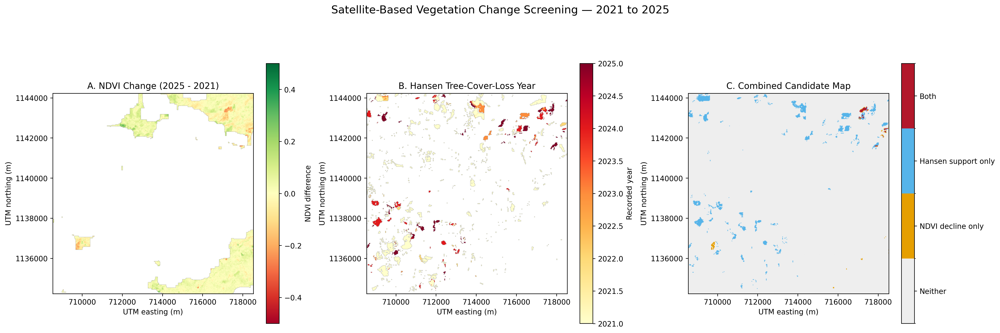

# 🌳 Satellite-Based Vegetation Change Detection & Forest-Loss Screening

<p align="center">
  <strong>Remote Sensing • Geospatial Analysis • Environmental Monitoring</strong>
</p>

<p align="center">
  
  
  
  
  
</p>

---

## 📌 Overview

**Satellite-Based Vegetation Change Detection and Forest-Loss Screening** is a remote-sensing project that analyzes satellite surface-reflectance imagery from 2021 and 2025 to identify areas of potential vegetation decline.

The workflow combines the **Normalized Difference Vegetation Index (NDVI)** with historical tree-cover and tree-cover-loss information from **Hansen Global Forest Change** to identify candidate regions requiring further investigation.

Using Python and geospatial raster-processing libraries, the project calculates vegetation-index changes, identifies connected candidate regions, cross-checks the results against independent reference data, and exports georeferenced outputs for further analysis.

> ⚠️ **Research note:** This is a preliminary screening workflow. Detected vegetation decline and overlap with historical tree-cover-loss data do not, by themselves, confirm permanent deforestation.

## 🗺️ Results Preview

<p align="center">
  
</p>

<p align="center">
  <em>Visualization of NDVI change, Hansen loss-year information, and combined candidate classes.</em>
</p>

## ✨ Key Features

- 🛰️ **Satellite imagery analysis** — Compare HLS S30 surface-reflectance observations from March 2021 and March 2025.
- 🌿 **NDVI computation** — Calculate vegetation-index values from red and near-infrared spectral bands.
- ☁️ **Quality masking** — Exclude cloud-affected, shadow-affected, and other invalid observations using quality information.
- 🔎 **Change detection** — Flag pixels with an NDVI change below a selected threshold.
- 🧩 **Connected-region analysis** — Group neighboring candidate pixels into spatial clusters.
- 🌳 **Historical cross-checking** — Compare candidates with Hansen historical canopy cover and recorded tree-cover loss.
- 🗺️ **Geospatial outputs** — Export GeoTIFF rasters and a consolidated visualization map.

## 🛠️ Tech Stack

| Category | Technologies |
|---|---|
| Programming language | Python |
| Numerical computation | NumPy |
| Geospatial raster processing | Rasterio |
| Coordinate transformations | PyProj |
| Visualization | Matplotlib |
| Connected-component analysis | SciPy |
| Development environment | Google Colab |
| Satellite imagery | NASA HLS S30 |
| Reference dataset | Hansen Global Forest Change |

## 🔬 Methodology

### 1. Satellite Data Acquisition

The original analysis uses the following HLS S30 products:

| Observation | Product identifier | Date |
|---|---|---|
| Baseline | `HLS.S30.T43PGM.2021088T050649.v2.0` | March 29, 2021 |
| Comparison | `HLS.S30.T43PGM.2025087T050659.v2.0` | March 28, 2025 |

The analysis uses the red and near-infrared bands to calculate NDVI. Quality information is used to identify invalid observations.

### 2. NDVI Calculation

The Normalized Difference Vegetation Index is calculated as:

\[
NDVI = \frac{NIR - Red}{NIR + Red}
\]

NDVI provides a spectral indicator associated with vegetation greenness. It is not a direct measurement of tree cover or proof of forest loss.

### 3. Vegetation Change Detection

The change between the two observations is calculated as:

\[
\Delta NDVI = NDVI_{2025} - NDVI_{2021}
\]

Pixels with valid observations in both years are compared. A pixel is flagged as a candidate when:

\[
\Delta NDVI < -0.15
\]

This threshold is a screening parameter used in the current experiment, not a universal deforestation threshold.

### 4. Connected-Region Analysis

Adjacent candidate pixels are grouped into connected regions. The largest cluster is examined separately to quantify its spatial overlap with historical canopy cover and recorded tree-cover loss.

### 5. Hansen Data Cross-Checking

Candidate regions are compared with:

- Historical tree-cover values from 2000, using a threshold of at least 30% canopy cover.
- Recorded Hansen tree-cover-loss years from 2021 through 2025.

This cross-check provides additional evidence for investigating potential forest disturbance. It does not independently establish the land-cover condition immediately before disturbance or whether the disturbance was permanent.

### 6. Geospatial Export

The workflow exports the NDVI-change raster, combined candidate-class raster, Hansen loss-year raster, and a visualization map.

## 📊 Preliminary Results

The two-date screening analysis produced the following results:

<p align="center">
  
  
  
</p>

| Metric | Result |
|---|---:|
| Pixels flagged by the NDVI-change threshold | 212 |
| Total candidate area | 19.08 ha |
| Largest connected candidate cluster | 70 pixels |
| Largest cluster area | 6.30 ha |
| Largest-cluster pixels meeting the historical canopy threshold | 68 |
| Largest-cluster pixels with recorded Hansen loss in 2021–2025 | 56 |
| Pixels meeting both screening criteria | 54 |
| Area meeting both criteria | 4.86 ha |
| Common valid coverage between the two observations | 14.11% |

Recorded Hansen tree-cover loss within the largest candidate cluster occurred in 2023, 2024, and 2025.

### Interpreting the Results

The 212 candidate pixels represent areas flagged by the NDVI-change threshold. The 54-pixel overlap represents locations within the largest cluster that meet both the historical canopy-cover and recorded-loss checks.

These measurements are **screening results, not a validated estimate of deforested area**. Limited common valid coverage, seasonal differences, and the age of the historical canopy baseline constrain the conclusions that can be drawn.

## 📁 Repository Structure

```text
satellite-forest-loss-detection/
│
├── README.md
├── requirements.txt
│
├── notebooks/
│   └── forest_loss_analysis.ipynb
│
└── results/
    ├── final_forest_loss_candidate_map.png
    ├── ndvi_change_2021_2025.tif
    ├── combined_candidate_classes.tif
    └── hansen_loss_year.tif
```

This is the intended structure. The committed filenames should match the actual repository contents.

## 📦 Installation & Reproducibility

### Prerequisites

- Python 3
- Google Colab or a compatible Jupyter environment
- The original satellite input bands and quality-mask data
- The relevant Hansen Global Forest Change raster data

### 1. Clone the Repository

```bash
git clone https://github.com/vxhll/satellite-forest-loss-detection.git
cd satellite-forest-loss-detection
```

### 2. Install Dependencies

```bash
pip install -r requirements.txt
```

### 3. Open the Notebook

Open `notebooks/forest_loss_analysis.ipynb` in Google Colab or Jupyter.

### 4. Obtain the Source Data

Retrieve the required satellite products through [NASA Earthdata Search](https://search.earthdata.nasa.gov/) and obtain the appropriate Hansen Global Forest Change data from the [Global Forest Change dataset page](https://glad.earthengine.app/view/global-forest-change).

Ensure that the selected products, acquisition dates, bands, and quality information match the analysis documented in the notebook.

### 5. Run the Analysis

Update the notebook's input paths, execute the cells in order, and inspect the generated visualization and GeoTIFF outputs.

**Reproducibility note:** The exported results alone are not sufficient to reproduce the complete analysis. The source data and processing workflow are also required.

## ⚠️ Limitations

- **Limited valid coverage:** Only 14.11% of the study-area crop had valid observations in both selected scenes.
- **Two-date comparison:** The current workflow compares two observations rather than a multi-date seasonal composite.
- **Seasonal variability:** Differences in rainfall, phenology, and vegetation conditions can influence NDVI.
- **Historical baseline:** The Hansen canopy-cover layer represents the year 2000 and does not establish forest cover immediately before the detected change.
- **Disturbance ambiguity:** Recorded tree-cover loss may represent harvesting, fire, temporary disturbance, or other causes; it does not necessarily mean permanent deforestation.
- **Threshold sensitivity:** The selected NDVI-change threshold requires further evaluation against independent reference data.
- **Validation requirement:** Candidate regions need additional clear observations and independent validation before definitive conclusions can be drawn.

## 🚀 Future Improvements

- [ ] Collect additional cloud-free satellite observations across comparable seasonal periods.
- [ ] Build seasonal median NDVI composites.
- [ ] Evaluate persistent vegetation decline across multiple years.
- [ ] Improve cloud and shadow screening.
- [ ] Validate candidate regions against independent reference data or high-resolution imagery.
- [ ] Develop an interactive map for spatial exploration.
- [ ] Evaluate detection performance using appropriately labelled reference samples.

## 👨‍💻 Author

**Vishal J**

- GitHub: [@vxhll](https://github.com/vxhll)
- LinkedIn: [Vishal J](https://www.linkedin.com/in/vishal-j-btech)

---

<p align="center">
  <strong>Remote Sensing · Geospatial Analytics · Environmental Monitoring</strong>
</p>

<p align="center">
  <em>Exploratory research for identifying potential vegetation changes that warrant further investigation.</em>
</p>
